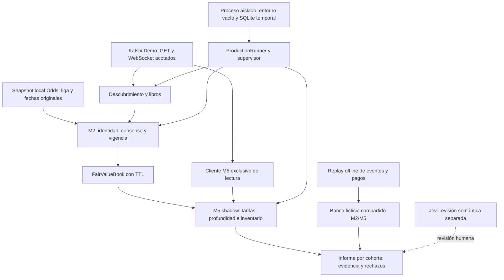

# Arquitectura M2/M5 del candidato local

Alcance: arrancar y validar el recorrido de datos en aislamiento, preservando las
reservas y los bloqueos. No activa ejecución, modifica producción ni certifica
rentabilidad. El código de lectura conjunta ahora conecta el adaptador de tarifas
Demo NFL/NCAA al arranque real de `ProductionRunner`.

## Contratos entre componentes

| Componente | Entrada y responsabilidad | Evidencia / límite |
|---|---|---|
| Configuración | Una liga, entorno Demo, ejecución apagada, límites F1 obligatorios. | Rechaza configuraciones incompatibles antes de iniciar clientes. Ambos opt-ins Demo son falsos por defecto. |
| Snapshot Odds | Archivo específico de la liga, antigüedad máxima 600 s, fechas originales y hash. | No refresca fechas ni consume API. El hash no autentica al proveedor. |
| M2 | Equipo por ticker/deporte, fecha ET, mínimo tres casas y vigencia de cuotas. | Publica fairs en memoria; no prueba equivalencia contractual. |
| FairValueBook | Metadatos de origen y fair con TTL de 360 s. | Datos vencidos bloquean propuestas M5. |
| M5 | Fair, libro, tarifa de serie y override de evento. | Cohorte Demo fútbol separada de la métrica operativa; sólo quotes/fills hipotéticos. |
| Cliente M5 | GET de serie, evento, mercado y libro en host fijo. | Sin API de creación/cancelación, sin retries/redirects/proxy; respuesta y tiempo acotados. |
| Supervisor | Arranque de servicios, propagación de fallos, apagado y conciliación de arranque. | Una parada durante la espera inicial M5 impide construir el motor. El harness no construye ejecutores. |
| Contabilidad ficticia | Reservas previas, fills parciales, cancelación observada, precio final explícito. | Reinicio y replay idempotentes; UNKNOWN conserva reserva. Vive en el simulador, no se injerta como saldo real. |
| Jev | Ayuda a revisar semántica. | No fija probabilidades, stake, órdenes ni autorización; no se llama durante este ensayo. |

## Recorridos reproducibles

`scripts/test_simulator_isolated.py` ejecuta la suite con base temporal, sin `.env`
y con sockets externos bloqueados. Incluye los tests del simulador compartido en
`infra/digitalocean-shadow/tests`. Los tests de
`tests/scripts/test_demo_multi_readiness.py` arrancan el runner real contra
transportes sintéticos y verifican propuestas y rechazos; no son capturas Demo.

`scripts/demo_multi_readiness.py` deja disponible el siguiente ensayo conectado
de lectura, descrito en [el procedimiento](demo_multi_readiness.md). Su modo por
defecto imprime un plan. Con datos válidos debe recorrer descubrimiento → M2 →
fair → M5 y terminar con ledger financiero vacío. Los presupuestos globales y el
proceso padre impiden convertir esta herramienta en un servicio indefinido.

## Estado que debe conservarse al entregar

- M1 conserva ejecución deshabilitada. Puede estar presente como detector shadow
  en el harness; ningún test constituye evidencia de edge de M1.
- M2/M5 tienen pruebas de arranque conjunto NFL/NCAA y pruebas de contabilidad
  ficticia. No equivalen a una validación de órdenes de producción.
- La orden IOC histórica de Demo conserva estado UNKNOWN y reserva ficticia de
  66¢. La respuesta de soporte del 10 de octubre no identifica su resultado; los
  listados vacíos de órdenes/fills no lo demuestran por sí solos.
- Las reglas de empate, suspensión, cancelación y pago de casas/Kalshi no son
  intercambiables. Falta ligar cada cuota a reglas/versiones aplicables y validar
  cualquier conversión de pago. No se etiqueta el consenso como fair certificado.
- Falta un recorrido conectado satisfactorio con datos frescos compatibles y una
  muestra prospectiva independiente para evaluar costes y ventaja.

La entrega resuelve preparación y pruebas locales del recorrido descrito. No
declara cerrados los pendientes de evidencia ni contiene un paso de activación.
